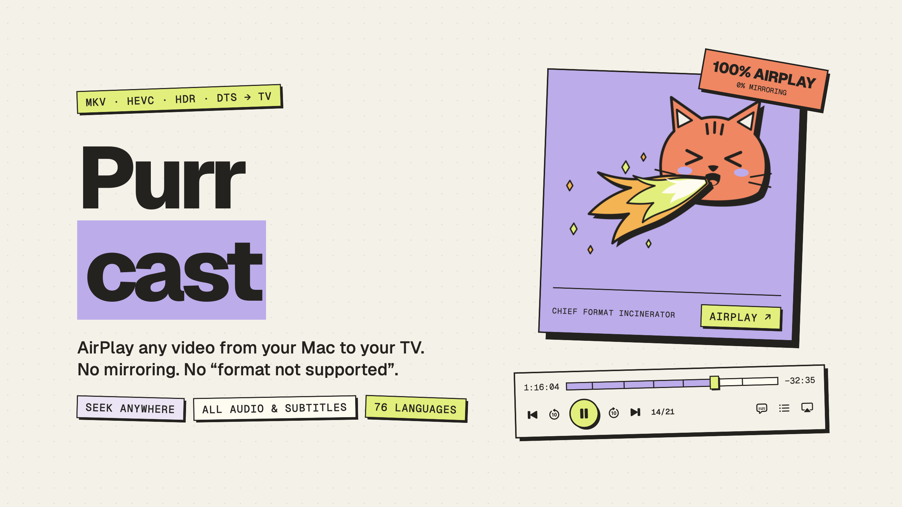

# Purrcast



macOS videólejátszó, ami MKV-t (és AVI-t, WebM-et stb.) is rendesen át tud küldeni AirPlay-jel TV-re / Apple TV-re: eredeti minőségben, több hangsávval és felirattal, nem képernyőtükrözéssel.

## Hogyan működik

Az AirPlay csak HLS/MP4 formátumot fogad H.264/HEVC videóval és AAC/AC-3/E-AC-3 hanggal, ezért MKV-t magától nem tud. Az app:

1. `ffprobe`-bal megnézi, milyen sávok vannak a fájlban,
2. `ffmpeg`-gel HLS streamet csinál belőle (fMP4 szegmensek). Alapból **kompatibilis módban**, aminek a célja, hogy minden AirPlay vevőn elinduljon (Apple TV HD/4K, Samsung, LG, Sony…):
   - videó: H.264 8 bit SDR, max. 1080p, 2 mp-es kulcskockák. A már pont ilyen H.264-et másolja, minden mást (HEVC, HDR/Dolby Vision, AV1, VP9, Xvid, MPEG-2, VC-1…) újrakódol. HDR-nél a VideoToolbox tone mappinget csinál, DVD-nél deinterlace és képarány javítás is van;
   - hang: AAC sztereó (DTS, TrueHD, E-AC-3 Atmos, FLAC stb. is), minden hangsáv megmarad és a TV-n választható;
   - ha valami mégsem indul el (ffmpeg hiba, lejátszó hiba, vagy 20 mp alatt nem indul a kép), automatikusan újrapróbálja egyre biztonságosabb beállítással (kötelező újrakódolás, majd szoftveres dekódolás);
   - **Lejátszás → Eredeti minőség**: HEVC/HDR/5.1 továbbítás újrakódolás nélkül, Apple TV 4K-hoz. Ha nem indul, visszaesik kompatibilis módra.
3. a szöveges feliratokat (SRT, ASS, beágyazott vagy a videó mellett lévő `Film.hun.srt`) WebVTT-re alakítja, a Windows-1250 kódolású magyar SRT-ket is,
4. beépített HTTP szerveren kiszolgálja a streamet; az AVPlayer ezt az URL-t adja át a TV-nek, ami közvetlenül a Macről streamel.

## Telepítés

Az app saját, beépített FFmpeg-gel fut (Homebrew nem kell hozzá). Az első `./build_app.sh` lefordítja a `scripts/build_ffmpeg.sh`-val (pár perc), utána a `vendor/ffmpeg`-ből másolja.

Build és telepítés az Alkalmazások mappába (az ikon a `Resources/Icon/make_icon.sh`-val generálható újra):

```bash
./build_app.sh --install
```

## Használat

- Húzd a videót az ablakra, vagy ⌘O, vagy Finderben: jobb klikk → Megnyitás ezzel → Purrcast.
- Az eszköztár AirPlay gombjával válaszd ki a TV-t.
- Hang- és feliratsáv: a lejátszó vezérlőin, vagy a TV-n az Apple TV távirányítóval.
- Nyelv: magyar és angol. Alapból a rendszer nyelvét követi, átállítható: **Purrcast menü → Nyelv** (újraindítja az appot).
- Napló a hibakereséshez (mit kért le a TV, lejátszó hibák): `~/Library/Logs/Purrcast.log`

Első indításkor a macOS megkérdezheti, hogy engedélyezed-e a bejövő kapcsolatokat / helyi hálózatot. Engedélyezd, különben a TV nem éri el a streamet.

## Funkciók (VLC-szerűen)

- **Lejátszási lista** (⌘L): fájlok, egész mappák, M3U listák; átrendezés húzással, ismétlés (ki / mind / egy), keverés, mentés M3U-ba. Újraindítás után is megmarad.
- **Bárhova tekerés** újrakódolás közben is: az újrakódolt videó 4 mp-es szegmensekben, igény szerint készül, és ha előreugrasz, az ffmpeg onnan indul újra.
- **Folytatás ott, ahol abbahagytad** („Elölről” gombbal), legutóbbi fájlok, hálózati stream megnyitása (⌘N; HTTP/HTTPS/RTSP/…; HLS linkek átalakítás nélkül mennek).
- Lejátszás: sebesség (`[` `]` `=`), ugrás ±10 mp (←/→, ⌥⌘←/→), ±1 perc (⇧⌘←/→), ugrás időpontra (⌘J), következő képkocka (E), A–B ismétlés (⌥⌘L), fejezetek.
- Hang: hangerő (↑/↓, ⌘↑/⌘↓), némítás, hangsáv választás. Felirat: sáv választás (V), feliratfájl hozzáadása lejátszás közben, késleltetés (G/H).
- Videó: teljes képernyő (⌘F, dupla kattintás), mindig felül, kitöltés módok, pillanatkép (⌥⌘S, a `~/Pictures/Purrcast` mappába, HDR-nél is helyes színekkel).
- Médiainformáció ablak (⌘I), billentyűzet médiagombjai, 76 nyelv (mint a VLC).

## Korlátok

- Képalapú feliratot (Blu-ray PGS, DVD VobSub) nem lehet WebVTT-re alakítani, ezeket kihagyja.
- Ha a videó újrakódolás nélkül megy át, és az átcsomagolás 8 mp-nél tovább tart (óriási fájl, hálózati meghajtó), addig csak az elkészült részig lehet tekerni.
- Lejátszás közben az ideiglenes stream nagyjából akkora helyet foglal, mint a videó; bezáráskor törlődik.
- A Mac nem alszik el, amíg a stream megy (a TV a Macről tölti a videót).

## Fejlesztés

```bash
swift build
swift run SmokeTest /útvonal/film.mkv   # stream + AVPlayer lejátszás + tekerés teszt (ugyanazt az URL-t kapja a TV is)
swift run SmokeTest --net <url>          # hálózati forrás
AIRPLAY_UI_SNAPSHOT=/tmp/ui swift run Purrcast film.mkv   # a felületről képek készülnek, majd kilép
swift run Purrcast /útvonal/film.mkv
```

A SmokeTest a `PURRCAST_FFMPEG_DIR` környezeti változóval az appba csomagolt FFmpeg-gel is futtatható:
`PURRCAST_FFMPEG_DIR=build/Purrcast.app/Contents/MacOS swift run SmokeTest film.mkv`

### FFmpeg és licencek

- `scripts/build_ffmpeg.sh` az FFmpeg 8.1.1-et (GPG-aláírással ellenőrzött forrás) **LGPL v2.1** szerint fordítja: `--enable-gpl` és nonfree részek nélkül, megosztott könyvtárakként (`Contents/Frameworks/*.dylib`, cserélhetők, ahogy az LGPL kéri), macOS 14+, Apple Silicon.
- Videókódolás: Apple VideoToolbox (nincs szükség a GPL-es x264/x265-re). HTTPS: OpenSSL 3.5 (Apache 2.0), statikusan.
- A licencszövegek az appban: Súgó → Nyílt forrású licencek (`Contents/Resources/Licenses`).
- Az ikonban nincs SF Symbol és Apple-logó (ezeket az Apple licence tiltja app ikonban); az „AirPlay” szó nem szerepel a névben, csak leíró jelleggel.

### Fordítás

A szövegek kulcsa az angol szöveg (`loc("...")`, `Text("...")`), a magyar fordítás a `Resources/Localization/hu.lproj/Localizable.strings`-ben van. Új szöveg után:

```bash
Resources/Localization/check.sh   # kiírja a hiányzó / felesleges fordításokat (a build_app.sh is lefuttatja)
```

Új nyelv: `xx.lproj` mappa ugyanezekkel a kulcsokkal, plusz a nyelvkód a `Resources/Info.plist` `CFBundleLocalizations` listájába és a nyelvválasztó menübe (`AppLanguage` az `App.swift`-ben).
